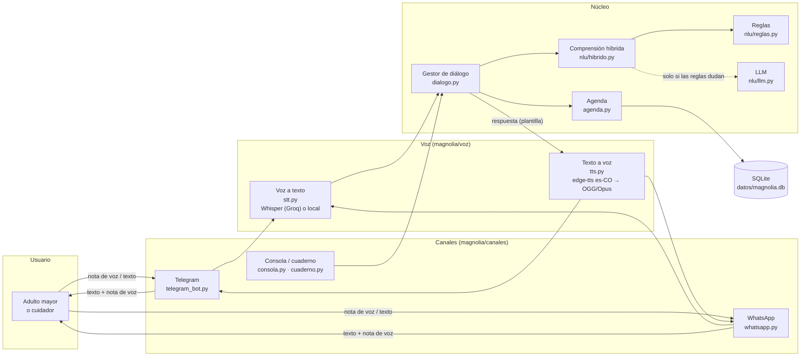
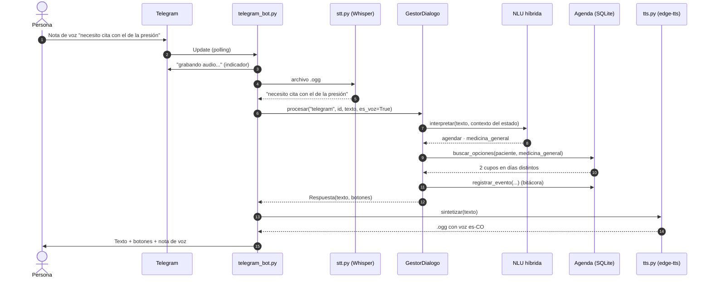
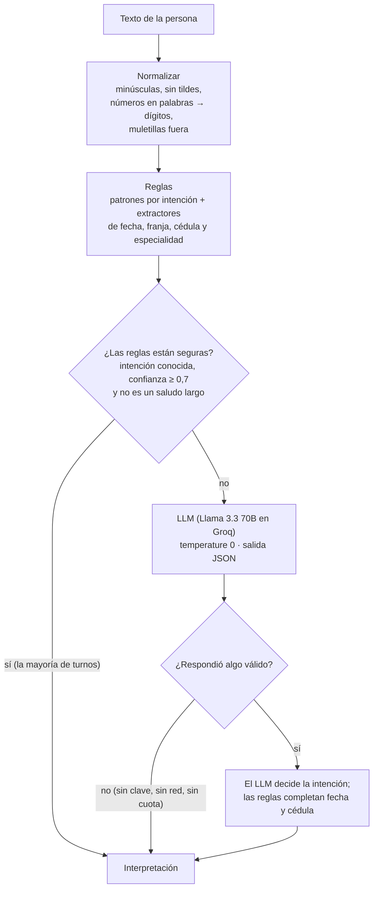
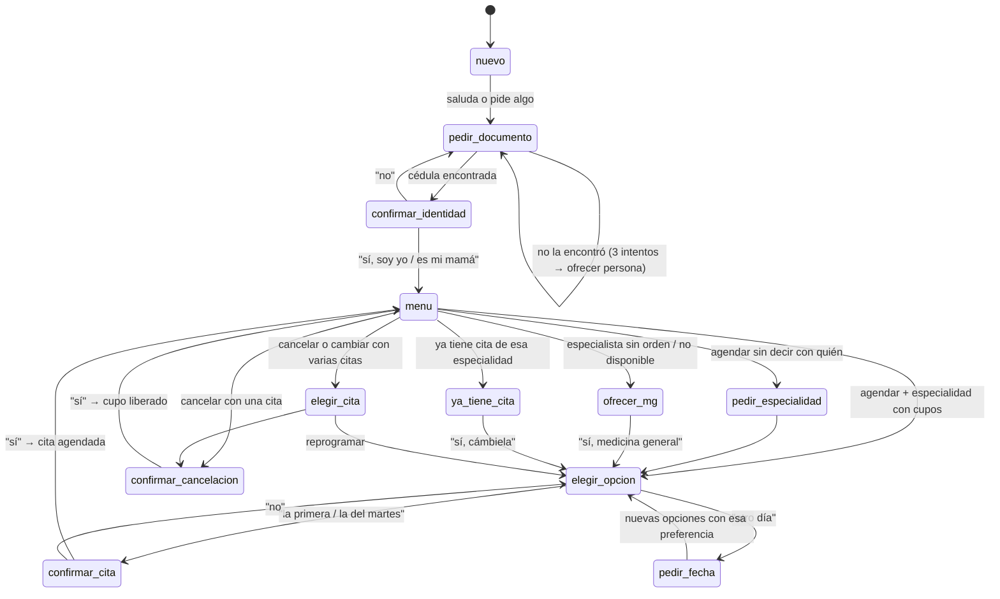
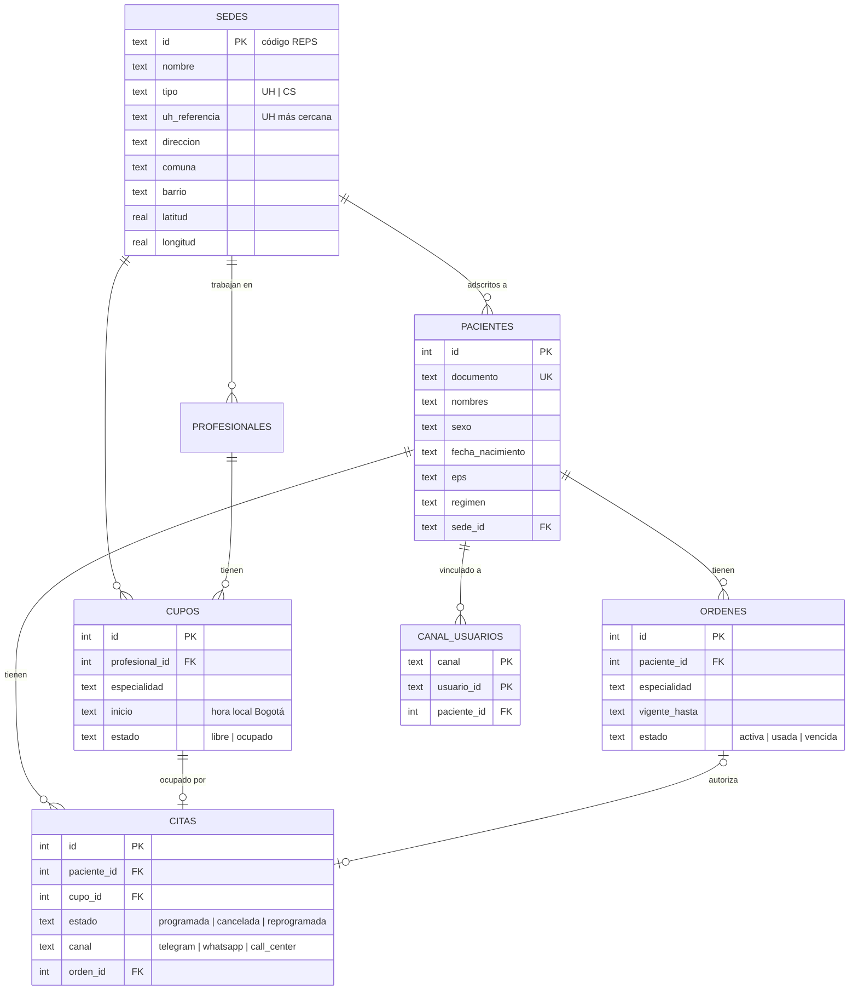
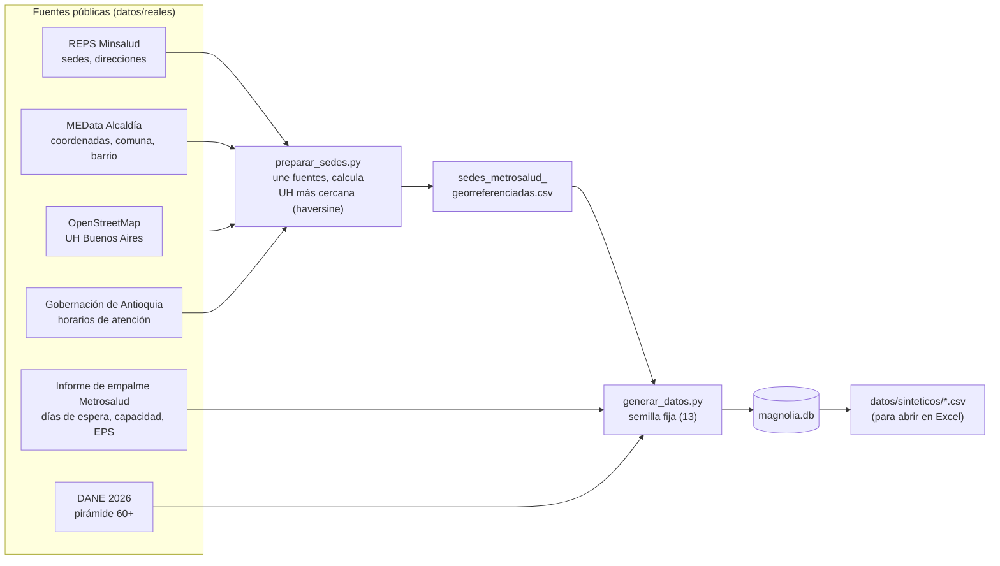

# Magnol-IA · Arquitectura y decisiones técnicas

Este documento explica **cómo está construido el MVP y por qué**. Los diagramas están en Mermaid: GitHub los dibuja solos al abrir este archivo.

- Para usarlo y probarlo: [`README.md`](../README.md) y [`GUIA_PRUEBAS.md`](GUIA_PRUEBAS.md).
- Para el origen de cada dato: [`datos/reales/FUENTES.md`](../datos/reales/FUENTES.md).

---

## 1. El problema técnico en una frase

Un adulto mayor manda una nota de voz como *"buenas mija, necesito una cita con el de la presión pa'l martes temprano"*. El sistema debe:

1. Convertir el audio a texto.
2. Entender qué quiere la persona.
3. Llevar una conversación corta y paciente hasta tener una cita confirmada en la agenda de la IPS.
4. Responder en texto y en voz.

Todo esto sin inventar horarios, sin dar consejos médicos y con **costo de operación de $0** para el MVP.

**Restricciones que guiaron el diseño:**

| Restricción | De dónde viene | Consecuencia en el diseño |
|---|---|---|
| Usuarios con poca destreza digital | Entregables 3 y 4 (entrevistas) | Voz en una app de mensajería que ya usan; sin app propia ni formularios |
| Presupuesto de $0 | Proyecto de curso | Solo servicios con plan gratuito; todo debe funcionar incluso sin ninguna clave |
| Datos clínicos reservados | Ley 1581 de 2012 y secreto médico | Agenda simulada, calibrada con datos públicos |
| Un error en salud es costoso | Dominio | El LLM nunca redacta lo que se le dice al paciente; las reglas de negocio son código determinista y probado |
| Equipo de 5 personas sin servidor | Contexto del curso | Corre en Google Colab o en cualquier PC con Python |

---

## 2. Vista general de componentes

**Idea central:** el **núcleo** (diálogo, comprensión y agenda) no sabe por qué canal llega el mensaje. Cada canal solo traduce: recibe audio o texto, llama a `GestorDialogo.procesar(canal, usuario, texto)` y devuelve la respuesta. Por eso el adaptador de WhatsApp ocupa menos de 200 líneas, y la consola, el cuaderno de Colab y las pruebas automáticas usan exactamente el mismo núcleo que el bot real.

| Módulo | Responsabilidad | Qué **no** hace |
|---|---|---|
| `canales/*` | Recibir y enviar mensajes, descargar audios, mostrar botones | No decide nada del negocio |
| `voz/stt.py` | Audio → texto | No interpreta |
| `nlu/*` | Texto → intención y datos (especialidad, fecha, franja, cédula, opción) | No consulta la agenda ni responde |
| `dialogo.py` | Estado de la conversación, reglas de negocio y textos de respuesta | No sabe de Telegram ni de SQL |
| `agenda.py` | Buscar cupos, reservar, cancelar y reprogramar de forma atómica | No sabe de lenguaje |
| `voz/tts.py` | Texto → nota de voz con voz colombiana | — |

---

## 3. Recorrido de una nota de voz

Detalles que importan:
- **Polling, no webhook, en Telegram.** El bot le pregunta a Telegram cada pocos segundos si hay mensajes nuevos. Así no hace falta una URL pública ni un servidor: funciona en Colab o en un PC detrás de cualquier router. La contrapartida es que **solo puede haber un proceso por token**; con dos, Telegram responde `Conflict`.
- **Nunca se deja a la persona sin respuesta.** Si algo falla dentro de un turno, `procesar` captura el error, registra el detalle y responde *"Disculpe, tuve un problema. ¿Me puede repetir qué necesita?"*.
- **Se muestra lo que se entendió.** Con `MOSTRAR_TRANSCRIPCION=true`, el bot responde *"Le entendí: «…»"* antes de contestar. Así la persona puede corregir si el audio se entendió mal, por ejemplo una cédula.

---

## 4. Comprensión del lenguaje: híbrida (reglas + LLM)

**Por qué híbrida y no solo LLM:**

| | Solo reglas | Solo LLM | **Híbrida (elegida)** |
|---|---|---|---|
| Costo por turno | $0 | Llamada a la API | $0 en la mayoría de los turnos |
| Latencia | Milisegundos | 0,3 a 2 s | Milisegundos en la mayoría |
| Funciona sin internet o sin clave | Sí | No | Sí (pasa a solo reglas) |
| Frases nunca vistas | 76 % de intención correcta | Mucho mejor | Las reglas resuelven lo fácil y el LLM lo raro |
| Fechas y cédulas | Deterministas y probadas | Puede equivocarse con "el otro martes" | Las calculan siempre las reglas |

**Reglas de seguridad del LLM:**
1. **Solo interpreta, nunca redacta.** Devuelve un JSON con `intencion`, `especialidad`, `fecha`, `franja`, etc. Lo que se le dice al paciente sale de plantillas escritas a mano en `dialogo.py`. Así es imposible que invente un horario, una dirección o un consejo médico.
2. **Su salida se valida contra el catálogo.** Una especialidad que no existe en `especialidades.csv` se descarta.
3. **`temperature 0`**, para que la misma frase dé siempre la misma interpretación.
4. **Si falla, no pasa nada grave:** el bot sigue con lo que entendieron las reglas.

**Lo que se aprendió con usuarios reales** (y quedó como prueba automática):
- *"Buenas tardes, es para saber cuáles son las citas que tengo"*: las reglas solo veían el saludo y lo daban por seguro. Ahora un saludo de más de 4 palabras se le pasa al LLM.
- *"Me la cancelaron, necesito que me la vuelvan a dar"* (entrevista ENT-002): se leía como un pedido de cancelar. Ahora "me la cancelaron" se reconoce como algo que hizo la IPS.
- Cédulas dictadas por grupos (*"29 28 57 72"*, *"2.92.85.772"*): ahora se unen los grupos.

---

## 5. Gestor de diálogo: una máquina de estados

Cada persona (por canal) tiene una **sesión** en memoria con su estado, el paciente identificado, las opciones ofrecidas y la última respuesta (para "¿me repite?"). Cada estado sabe qué espera y le dice a la NLU en qué **contexto** está. Así, un "la segunda" o un "sí" se entienden según lo que se acaba de preguntar.

**Transversales (en cualquier estado, antes que todo lo demás):**
- **Urgencia** (*"me duele el pecho"*, *"me desmayé"*): indica llamar al 123 de inmediato.
- **Riesgo de hacerse daño** (*"me quiero morir"*): mensaje específico que pide llamar ya a la línea 123.
- **"¿Me repite?"**: devuelve la última respuesta tal cual.
- **"Hablar con una persona"**: explica cómo comunicarse con la IPS.
- **"Menú" o "empezar de nuevo"**.

**Decisiones de diseño conversacional para adultos mayores:**

| Decisión | Por qué |
|---|---|
| Máximo **2 opciones**, en **días distintos** | Recordar más de dos fechas habladas es difícil; si las dos son el mismo día, no hay elección real |
| Confirmación **sí/no** antes de agendar, cambiar o cancelar | Un error de comprensión no debe convertirse en una cita equivocada |
| Fechas y horas dichas como se hablan (*"el martes 17 de noviembre, a las 7 y 20 de la mañana"*) | Las notas de voz leen el texto tal cual; "07:20" se oye mal |
| Trato de "don/doña" y frases cortas | Entrevistas: *"hablan muy rápido y no tienen paciencia"* |
| Cuidadores: *"es para mi mamá"* | Hipótesis ajustada del E3: el problema sobrecarga a la red de apoyo |
| Botones grandes, uno por fila | Alternativa a la voz para quien prefiere tocar |
| Voz un poco más lenta (−10 %) | Comprensión al oír |

---

## 6. Agenda y reglas de negocio

**Búsqueda de opciones** (`agenda.buscar_opciones`):
1. Busca primero en la **sede del paciente**. Para especialistas, en la **unidad hospitalaria más cercana**, calculada con coordenadas reales.
2. Aplica las preferencias: desde una fecha, mañana o tarde, desde una hora, excluyendo días ya ofrecidos.
3. Exige al menos 2 horas de anticipación.
4. Devuelve hasta 2 cupos **en días distintos**.
5. Si no hay, amplía a otras sedes.

**Reglas del sistema de salud codificadas:**

| Regla | Implementación |
|---|---|
| Especialistas solo con orden vigente | `ordenes.estado='activa'` y `vigente_hasta >= hoy`; al agendar, la orden pasa a `usada` |
| Sin orden → medicina general | El diálogo lo ofrece (estado `ofrecer_mg`) |
| No duplicar citas de la misma especialidad | Si ya tiene una, ofrece cambiarla |
| Especialidad que la red no presta vs. que no se agenda por este canal | Columna `portafolio_metrosalud` del catálogo: mensajes distintos |
| Festivos | Librería `holidays` (Colombia): la agenda no los tiene y el bot avisa si se pide uno |

**Concurrencia: reserva atómica.** Cinco personas probando el mismo bot pueden pedir el mismo cupo al mismo tiempo. La reserva es una transacción SQLite `BEGIN IMMEDIATE` con `UPDATE cupos SET estado='ocupado' WHERE id=? AND estado='libre'`. Si `rowcount` no es 1, otra persona lo tomó primero: se hace `ROLLBACK` y el diálogo ofrece otro cupo. Reprogramar es reservar el nuevo cupo y liberar el anterior **en la misma transacción**: nunca queda la persona sin cita ni con dos.

---

## 7. Modelo de datos

Más dos tablas de soporte: `eventos`, la **bitácora** de cada turno (base de las métricas y de la mejora de la comprensión), y `metadatos` (fecha de generación, semilla y rango de la agenda).

**Por qué SQLite:** viene con Python, no requiere servidor, cabe en un archivo y soporta transacciones reales, que la reserva atómica necesita. Con unos 220.000 cupos y un índice sobre `(especialidad, estado, sede_id, inicio)`, cada búsqueda tarda milisegundos. En producción, esta capa se reemplaza por la API del software de agendas de la IPS. Por eso todo el acceso a datos está aislado en `agenda.py`.

---

## 8. De dónde sale la data

**Cómo se calibra la agenda:** para cada sede y especialidad, el generador marca como ocupados los cupos de los primeros días. Lo hace con una probabilidad que baja con el tiempo, de modo que el **primer cupo libre aparezca, en promedio, a los días de espera reales de Metrosalud**. Por ejemplo, medicina general a unos 2 días hábiles (3 días calendario en 2023). La tabla `resumen_calibracion.csv` compara el objetivo con lo simulado.

**Reproducibilidad:** todo usa una semilla fija. Los pacientes usan un generador aparte del de la agenda, así que **las cédulas son las mismas sin importar el día** en que se genere. Lo único que cambia son las fechas de las citas.

---

## 9. Voz

| Pieza | Elección | Alternativas consideradas | Por qué |
|---|---|---|---|
| Voz a texto | **Whisper large-v3-turbo en Groq** (plan gratuito) | Google STT (de pago), Vosk (menos preciso en español coloquial), Whisper local | Muy preciso en español, rápido y gratis. Se le pasa un vocabulario de pista (especialidades, sedes, "cédula") para mejorar los términos médicos y paisas |
| Respaldo de voz a texto | **faster-whisper** en el propio computador | — | Funciona sin internet ni cuenta (más lento) |
| Texto a voz | **edge-tts**, voz `es-CO-SalomeNeural` | gTTS (voz robótica, acento de España), Azure (de pago) | Voz neuronal colombiana, gratis. Si falla, pasa a gTTS automáticamente |
| Formato | **OGG/Opus** (con ffmpeg) | MP3 | Es el formato nativo de las notas de voz de Telegram y WhatsApp: se ve y suena como un audio normal, no como un archivo adjunto |

---

## 10. Decisiones técnicas (resumen tipo ADR)

| # | Decisión | Alternativas | Razón | Costo que se acepta |
|---|---|---|---|---|
| 1 | Notas de voz en mensajería existente | App propia, web, llamada telefónica | E3: los canales puramente digitales no lo resuelven; ya usan mensajería | Depender de la plataforma |
| 2 | Telegram para el MVP; WhatsApp listo | Solo WhatsApp | Desde oct-2026 Meta cobra cada respuesta de un negocio; Telegram es gratis y acepta voz igual | Los adultos mayores usan más WhatsApp: en un piloto real conviene WhatsApp, pagado por la IPS |
| 3 | Comprensión híbrida | Solo reglas, solo LLM | Costo $0, funciona sin red y el LLM resuelve lo difícil (ver sección 4) | Mantener reglas |
| 4 | LLM solo interpreta; respuestas por plantilla | LLM conversacional libre | Seguridad clínica: no puede inventar horarios ni aconsejar | Respuestas menos variadas |
| 5 | Máquina de estados explícita | Diálogo 100 % generado por LLM | Predecible, probable con pruebas automáticas y auditable | Más código para cada flujo |
| 6 | Agenda simulada calibrada con datos reales | Pedirle la agenda a una IPS | Los datos clínicos son reservados; la integración real es el reto del piloto | No es la agenda real |
| 7 | SQLite | PostgreSQL, Firebase | Cero instalación, transacciones reales, un archivo | No escala a muchas IPS (no es la meta del MVP) |
| 8 | Polling en Telegram | Webhook | No necesita servidor ni URL pública; corre en Colab | Un solo proceso por token |
| 9 | Python puro, pocas dependencias | Frameworks de bots (Rasa, Dialogflow) | Todo el equipo lo entiende, corre en Colab, sin cuentas extra | Menos funciones "de caja" |
| 10 | Sesiones en memoria; identidad y citas en la base | Todo persistente | Simple; si el bot se reinicia solo se pierde la conversación en curso | Una conversación a medias se reinicia |

---

## 11. Seguridad y privacidad

- **Identidad:** el MVP confirma por nombre. Con `VERIFICAR_NACIMIENTO=true`, además pide el año de nacimiento **sin revelar el nombre** antes. Para producción se recomienda un código de un solo uso.
- **Bitácora anónima al exportar:** el identificador de Telegram o WhatsApp se reemplaza por un código derivado con SHA-256. Las bitácoras no se suben a GitHub (`.gitignore`).
- **WhatsApp:** el webhook verifica la firma HMAC de Meta y descarta mensajes repetidos (Meta reintenta los envíos).
- **Claves:** se leen de `.env` o de los Secretos de Colab. Las claves que quedaron en el cuaderno del repo son temporales para la demo y deben revocarse al terminar.
- **Consentimiento:** antes de probar con personas reales se pide autorización (Ley 1581 de 2012). El texto está en la guía de pruebas.

---

## 12. Calidad: cómo se sabe que funciona

| Mecanismo | Qué mide | Dónde |
|---|---|---|
| **75 pruebas automáticas** (pytest) | Flujos completos, reglas de negocio, concurrencia, urgencias, festivos, canales, LLM y voz simulados, y que la data respete las fuentes reales | `tests/` |
| **Evaluación de comprensión** | % de intención y datos correctos sobre 190 frases etiquetadas: desarrollo, prueba, frases posteriores, **entrevistas** y **pruebas reales** | `scripts/evaluar_nlu.py` |
| **Métricas de uso** | Tasa de éxito al agendar, turnos y minutos hasta agendar, % no entendido, % que pidió una persona, % por voz, reglas frente a LLM | `scripts/metricas.py` |
| **Verificación de claves** | Que el token, el LLM y la voz a texto funcionen de verdad | `scripts/verificar_claves.py` (paso 2b) |

El ciclo de mejora es: **probar con personas → exportar la bitácora → marcar lo que entendió mal → agregarlo a las frases → corregir → la prueba automática evita que vuelva a fallar.**

---

## 13. Del MVP a un piloto real

| Pieza | Hoy (MVP) | Piloto con una IPS |
|---|---|---|
| Agenda | SQLite simulada | Integración con la API del software de citas de la IPS (el reto principal) |
| Canal | Telegram | WhatsApp Business (costo por mensaje asumido por la IPS) |
| Identidad | Nombre (+ año de nacimiento opcional) | Código de un solo uso al celular registrado |
| Despliegue | Colab o un PC | Servidor en la nube con webhook y monitoreo |
| Sesiones | Memoria | Redis o base de datos, para sobrevivir reinicios |
| Comprensión | Reglas + Llama en Groq (gratis) | Igual, con frases reales de los usuarios y límites de pago |
| Extensiones | — | Recordatorios por voz antes de la cita (inasistencia del 17 %), reagendar citas canceladas por la IPS |
